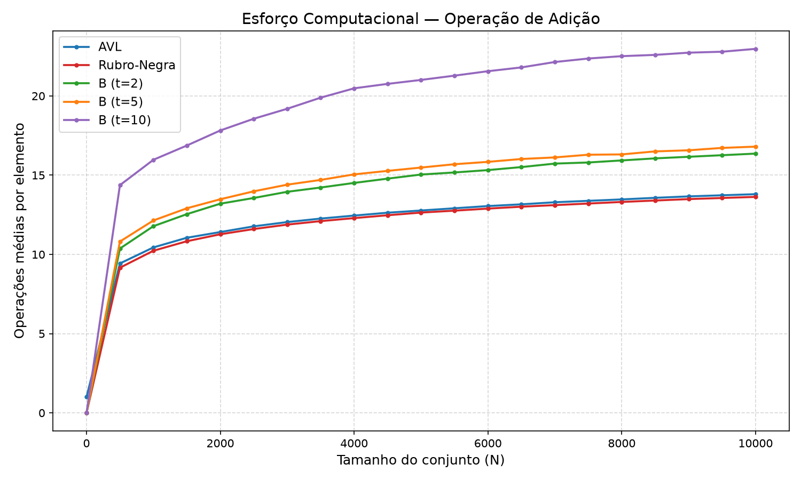
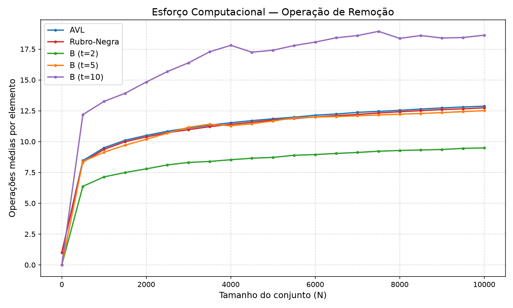

# Análise de Complexidade Algorítmica em Estruturas de Dados de Árvore

## Introdução

Este relatório apresenta uma análise comparativa da complexidade algorítmica das operações de adição e remoção de nós em três tipos de árvores de busca balanceadas: Árvores AVL, Árvores Rubro-Negras e Árvores B. A análise foi realizada considerando diferentes graus mínimos para as Árvores B (t=2, t=5 e t=10). O objetivo é quantificar o esforço computacional médio dessas operações em função do tamanho do conjunto de dados, variando de 1 a 10.000 chaves aleatórias.

## Metodologia

Foram implementadas em linguagem C as estruturas de dados de Árvore AVL, Árvore Rubro-Negra e Árvore B. Cada implementação inclui as operações de inserção e remoção completas, com os algoritmos de balanceamento inerentes a cada tipo de árvore. Para medir o esforço computacional, foi utilizado um contador global por estrutura, incrementado a cada operação fundamental realizada: comparações e visitas a nós durante a busca, rotações (AVL e Rubro-Negra) e divisão/fusão/empréstimo de nós (Árvore B).

Foram gerados conjuntos de chaves aleatórias para tamanhos de N variando entre 1 e 10.000. Para cada tamanho de N, foram coletadas 10 amostras e calculada a média do número de operações por elemento, garantindo validade estatística e reprodução do caso médio. As chaves foram geradas com a função `rand()` do C com semente fixa (`srand(42)`) para reprodutibilidade, e a ordem de inserção e remoção foi aleatorizada a cada amostra. Os resultados foram armazenados em CSV e os gráficos gerados com um script Python (matplotlib).

## Resultados

Os experimentos geraram os seguintes dados de esforço computacional (operações médias por elemento):

```
N,AVL_Add,AVL_Rem,RB_Add,RB_Rem,B1_Add,B1_Rem,B5_Add,B5_Rem,B10_Add,B10_Rem
1,1.00,1.00,0.00,1.00,0.00,0.00,0.00,0.00,0.00,0.00
500,9.43,8.46,9.16,8.33,10.37,6.37,10.81,8.38,14.37,12.19
1000,10.44,9.50,10.23,9.37,11.78,7.14,12.14,9.14,15.97,13.26
1500,11.05,10.11,10.83,9.99,12.54,7.49,12.91,9.71,16.87,13.92
2000,11.41,10.50,11.27,10.38,13.20,7.79,13.48,10.19,17.82,14.83
2500,11.77,10.84,11.60,10.72,13.56,8.11,13.98,10.68,18.56,15.68
3000,12.04,11.10,11.88,10.97,13.95,8.31,14.40,11.16,19.19,16.39
3500,12.26,11.33,12.10,11.21,14.22,8.39,14.70,11.41,19.89,17.28
4000,12.45,11.53,12.29,11.40,14.51,8.53,15.05,11.28,20.48,17.81
4500,12.63,11.70,12.47,11.57,14.78,8.65,15.27,11.45,20.76,17.25
5000,12.77,11.85,12.64,11.75,15.04,8.72,15.48,11.67,21.01,17.41
5500,12.91,11.98,12.76,11.87,15.17,8.89,15.69,11.92,21.28,17.79
6000,13.05,12.14,12.89,12.00,15.32,8.95,15.84,11.99,21.56,18.07
6500,13.16,12.24,13.01,12.11,15.51,9.04,16.02,12.03,21.80,18.42
7000,13.29,12.37,13.11,12.20,15.73,9.12,16.12,12.09,22.14,18.60
7500,13.38,12.45,13.21,12.32,15.80,9.22,16.29,12.16,22.36,18.94
8000,13.47,12.54,13.31,12.42,15.93,9.28,16.31,12.22,22.51,18.37
8500,13.57,12.64,13.40,12.51,16.06,9.32,16.50,12.28,22.59,18.60
9000,13.66,12.73,13.49,12.60,16.16,9.36,16.57,12.35,22.73,18.40
9500,13.73,12.81,13.56,12.66,16.26,9.45,16.72,12.43,22.79,18.44
10000,13.80,12.87,13.63,12.74,16.36,9.49,16.80,12.51,22.97,18.63
```

### Gráfico de Adição



### Gráfico de Remoção



## Discussão dos Resultados

Os gráficos de adição e remoção ilustram o comportamento do esforço computacional médio por elemento para cada estrutura de dados. Observa-se que, para ambas as operações, o número de operações por elemento cresce de forma logarítmica com o aumento de N, resultado esperado para árvores de busca balanceadas com altura O(log N).

**Árvores AVL e Rubro-Negras:** As duas estruturas apresentam desempenho muito próximo entre si, consistentemente inferior às Árvores B em termos de operações por elemento. Na operação de adição, AVL e Rubro-Negra ficam quase sobrepostas ao longo de toda a faixa testada (em N=10.000, AVL registra 13,80 e RB registra 13,63). Na remoção, o padrão se mantém semelhante (AVL: 12,87; RB: 12,74 em N=10.000). A ligeira vantagem da Rubro-Negra na remoção pode ser atribuída ao fato de que sua estratégia de rebalanceamento por recoloração tende a evitar rotações em mais casos do que a AVL, que prioriza balanceamento mais rígido de alturas. Em adição, a AVL realiza verificações de altura adicionais, o que pode explicar o contador ligeiramente maior.

**Árvores B:** As Árvores B apresentam consistentemente maior número de operações por elemento em comparação com as árvores binárias, em especial na operação de adição. Esse comportamento se deve ao fato de que nós com múltiplas chaves exigem busca linear interna ao nó durante a inserção e remoção, incrementando o contador de operações a cada comparação dentro de um mesmo nó.

Na **adição**, quanto maior o grau mínimo t, maior o esforço medido (B t=2: 16,36; B t=5: 16,80; B t=10: 22,97 em N=10.000). Nós com t maior armazenam mais chaves por nó, reduzindo a altura da árvore, mas aumentando o trabalho de comparação e divisão dentro de cada nó, o que o contador captura.

Na **remoção**, o comportamento é distinto: o Árvore B com t=2 apresenta o menor esforço dentre as B-Trees (9,49 em N=10.000), enquanto B t=5 e B t=10 mostram valores maiores (12,51 e 18,63 respectivamente). Isso ocorre porque nós maiores exigem mais operações de fusão e empréstimo para manter o invariante de ocupação mínima (t-1 chaves por nó não-raiz). A remoção na Árvore B com t=2 é também mais barata do que a inserção (9,49 vs 16,36), diferença mais pronunciada do que nas árvores binárias.

É importante ressaltar que esta análise mede operações internas em memória. O principal campo de aplicação das Árvores B é o armazenamento em disco, onde o número de acessos a blocos é o gargalo real. Nesse cenário, a altura reduzida das B-Trees com t maior representaria uma vantagem decisiva, pois cada nível da árvore corresponde a um acesso a disco.

## Conclusão

A análise demonstrou que, para operações em memória principal, Árvores AVL e Rubro-Negras são mais eficientes em termos de esforço computacional por elemento do que as Árvores B, para ambas as operações de adição e remoção. As diferenças entre AVL e Rubro-Negra são marginais, com crescimento logarítmico suave e próximo para os dois casos. As Árvores B, embora apresentem custo maior em operações internas, têm sua eficiência justificada em cenários de armazenamento secundário, onde a minimização de acessos a disco é o critério dominante. A escolha da estrutura de dados deve, portanto, ser orientada pelo ambiente de execução e pelo perfil de acesso da aplicação.

## Referências

[1] Cormen, T. H., Leiserson, C. E., Rivest, R. L., & Stein, C. (2009). *Introduction to Algorithms* (3rd ed.). MIT Press.
[2] Weiss, M. A. (2014). *Data Structures and Algorithm Analysis in C++* (4th ed.). Pearson.
